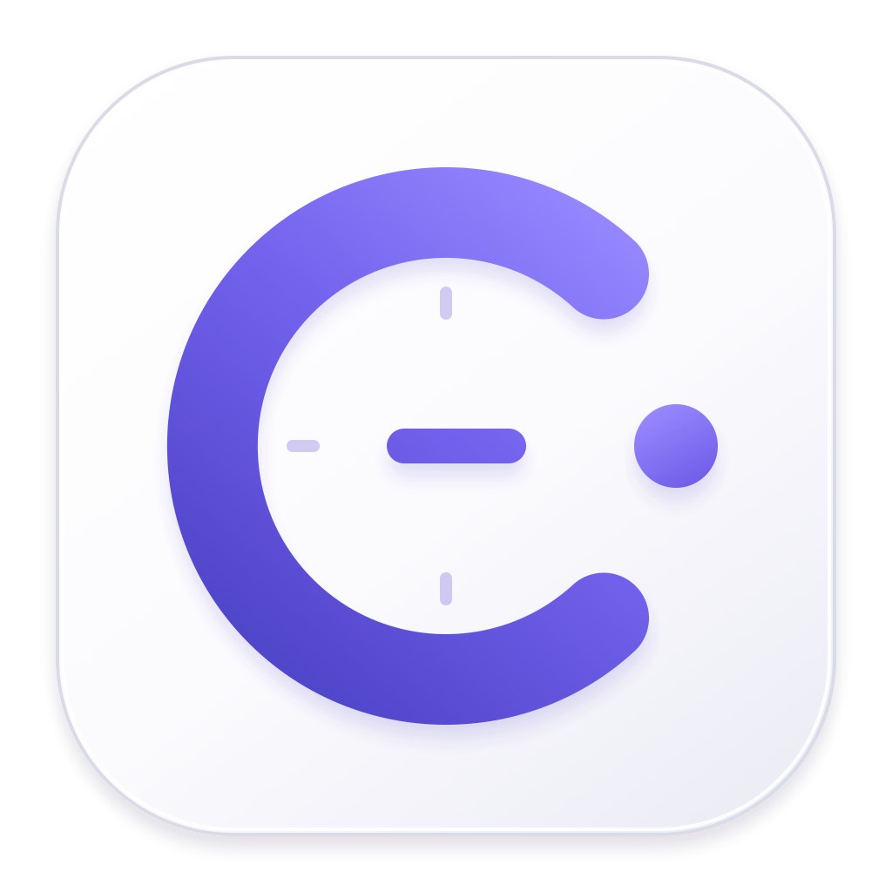
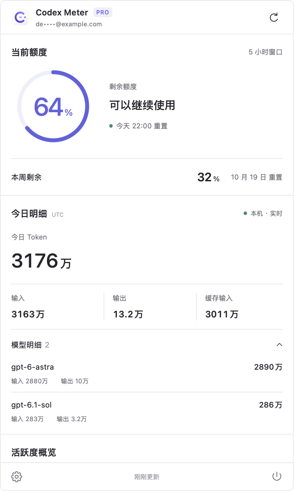
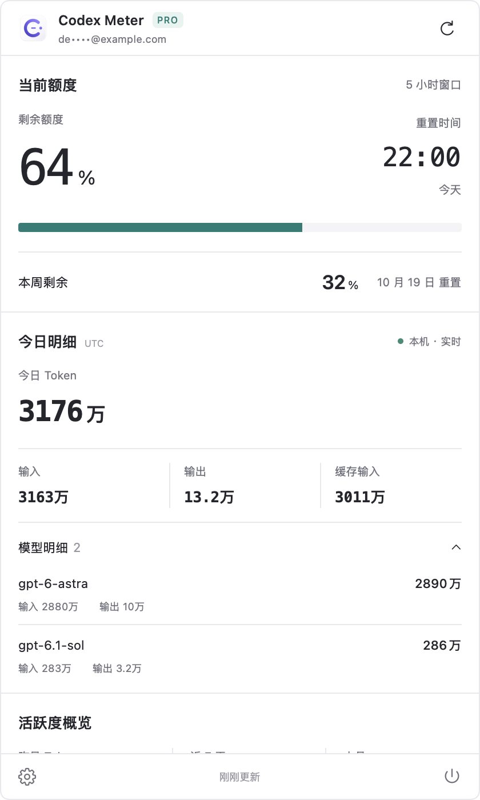
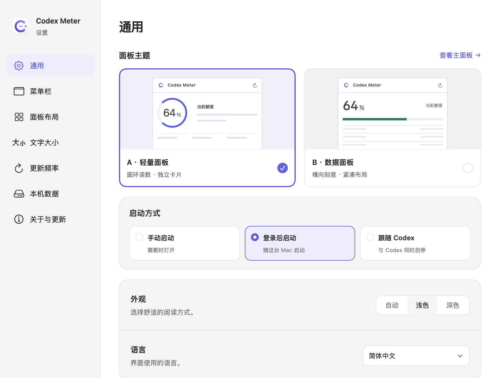

# Codex Meter 2.0

[简体中文](README.md) · 繁體中文 · [English](README.en.md) · [日本語](README.ja.md) · [한국어](README.ko.md) · [Español](README.es.md)



原生 macOS 選單列工具，用來查看 Codex 帳號額度、跨裝置用量與本機即時 Token。點選選單列項目即可開啟面板。

Codex Meter 是獨立開源專案，與 OpenAI 無隸屬關係。

[下載 v2.0.0](https://github.com/JTXYH/codex-meter/releases/download/v2.0.0/CodexMeter-2.0.0-macOS.zip) · [版本說明](https://github.com/JTXYH/codex-meter/releases/tag/v2.0.0) · [回報問題](https://github.com/JTXYH/codex-meter/issues)

## 畫面

截圖使用示範資料。

| A · 輕量面板 | B · 資料面板 |
| --- | --- |
|  |  |



## 功能

- **兩種主題**：輕量主題使用紫色圓環，資料主題使用綠色橫向刻度。設定中心跟隨主題強調色，兩種主題均支援系統、淺色與深色外觀。
- **額度與重設時間**：選單列顯示剩餘額度，優先使用 5 小時視窗，僅有每週額度時自動切換。面板顯示帳號傳回的額度視窗與重設時間；可自訂可繼續使用、額度即將用盡、等待恢復等狀態文字。
- **今日明細**：每 5 秒增量讀取本機當天的 Token 計數，顯示輸入、輸出、快取輸入與模型明細。
- **帳號歷史**：依日、週、月、年查看官方帳號介面傳回的 Token 總量，包含其他裝置與雲端任務。顯示使用過的模型、Fast 標記，以及介面資料支援的使用比例。
- **活躍度**：昨日、近 7 天、本月用量，120 天熱圖，以及介面傳回的累計 Token、連續使用天數與最長單次任務。
- **充值卡**：顯示官方介面傳回的可用數量及每張卡的到期日期和時間，依到期時間排序。僅供查看，不會兌換卡片或重設額度。
- **Credits 餘額**：顯示帳號額外用量餘額，換算方式見下表。
- **統一設定**：卡片顯示與拖曳排序、選單列圓環大小、整體或個別卡片字級、更新頻率、啟動方式、語言與本機資料清理。
- **更新與隱私**：透過 Sparkle 在 App 內更新；電子郵件地址預設遮蔽，點選可暫時顯示，關閉面板後重新隱藏。

介面支援簡體中文、繁體中文、English、日本語、한국어 與 Español。首次啟動會比對系統偏好語言，無相符項目時使用英文。

## 安裝與使用

需要 macOS 14 Sonoma 或更新版本，支援 Apple Silicon 與 Intel Mac。請先安裝 [Codex 桌面 App 或 CLI](https://github.com/openai/codex)，並以 ChatGPT 帳號登入。

1. 從 [GitHub Releases](https://github.com/JTXYH/codex-meter/releases/latest) 下載 ZIP，解壓縮後將 `CodexMeter.app` 拖入「應用程式」。
2. 啟動 Codex Meter，點選選單列的額度圓環開啟面板。
3. 右上角按鈕手動重新整理；左下角齒輪開啟設定；右下角電源按鈕結束 App。
4. 在設定中選擇手動啟動、登入後啟動或跟隨 Codex 啟停。後兩種方式不能同時開啟；跟隨啟停需要封裝後的 App，並可能需要在 macOS「登入項目與延伸功能」允許背景輔助程式。

建置腳本預設採用 ad-hoc 簽章，不代表經過 Apple 公證。若 macOS 阻止首次開啟，請先確認下載來源與 Release 的 SHA-256 校驗檔，再透過「系統設定 → 隱私權與安全性」中的「強制打開」處理。

正式版本可在「關於與更新」檢查更新，也會每 6 小時自動檢查。更新套件通過 Sparkle 驗證後才安裝；開發模式不會自動檢查更新。

## 資料來源

| 內容 | 來源與計算方式 |
| --- | --- |
| 帳號、額度、重設時間 | 本機 Codex CLI 的官方 `app-server` 介面：`account/read`、`account/rateLimits/read`。 |
| 歷史 Token、熱圖、帳號摘要 | `account/usage/read` 傳回的帳號統計。未傳回的日期保留為缺漏，不以本機紀錄補齊。 |
| 歷史模型與比例 | 官方帳號的 `daily-token-usage-breakdown` 介面。比例為同一次回應中各模型 `credits` 權重總和除以全部權重，並非 Token 比例或美元費用；權重缺漏時只顯示模型。 |
| 今日 Token 與模型明細 | 本機 Codex 工作階段與封存日誌中的當天計數事件，僅涵蓋這台 Mac。 |
| 充值卡 | `account/rateLimits/read` 的 `rateLimitResetCredits`。數量取自 `availableCount`，到期時間取自可用卡片明細；明細缺漏時保留官方數量並顯示提示。 |
| Credits 餘額 | 官方傳回的 Credits 餘額，App 以固定 `1 Credit = US$0.04` 換算顯示，並非依 Token 計算的 API 費用。 |

今日與歷史統計統一使用 **UTC 日期邊界**，避免本地「今天」與介面「昨天」重複計入。每週以 UTC 週一至週日計算；額度重設與卡片到期時間使用 Mac 目前的時區。歷史中的今日資料完全以介面回應為準，不加入本機即時計數。

API 費用計算與相關設定已移除。API Key 或 Amazon Bedrock 登入可能無法提供 ChatGPT 帳號額度、模型歷史或充值卡資訊；介面也可能延遲或缺少欄位。重新整理失敗時保留上次成功資料，首次失敗則提供重試入口。

## 本機資料與隱私

設定、本機計數與日誌讀取位置保存在：

```text
~/Library/Application Support/CodexMeter/meter.sqlite
```

SQLite 使用 WAL 與交易。帳號額度、歷史統計及模型結果僅快取於記憶體。App 只擷取日誌中的用量計數，不保存或上傳對話內容。

模型歷史請求使用 `$CODEX_HOME/auth.json`（預設 `~/.codex/auth.json`）中既有的 ChatGPT 登入資訊，核對帳號後向 `chatgpt.com` 發送請求。存取權杖不會寫入 App 資料庫或日誌。

「設定 → 本機資料」可依保留天數或全部清除已儲存的本機統計，不刪除 Codex 原始日誌、帳號統計或設定。清理邊界會保留，已清除的舊事件不會在重新啟動後再次匯入。

請勿在公開 Issue 中附上存取權杖、`auth.json`、完整電子郵件地址或原始帳號回應。

## 從原始碼建置

需要 Swift 6 工具鏈（Xcode 16 或更新版本）。

```bash
git clone https://github.com/JTXYH/codex-meter.git
cd codex-meter
./scripts/build-app.sh release
```

產物位於 `dist/CodexMeter.app`。每次建置會先清空專案 `dist/` 內的舊產物。App 優先使用手動指定的 CLI；自動搜尋時優先使用 Codex/ChatGPT 桌面 App 內建版本，再搜尋常見 CLI 安裝位置。

```bash
swift run CodexMeter
swift test
```

封裝與簽章步驟請參考[發布指南](docs/releasing.md)。`master` 為 2.0 版本；發布前線上的 `master` 保存在 [V1.0 分支](https://github.com/JTXYH/codex-meter/tree/V1.0)。

## 授權

[MIT License](LICENSE)
